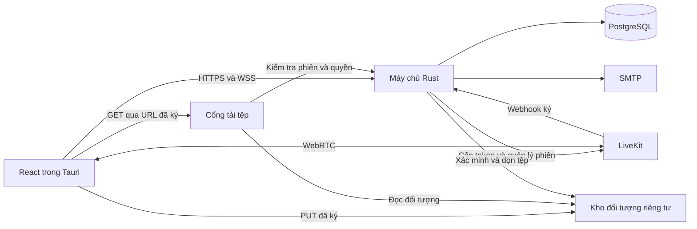

# Thiết kế máy chủ Rust cho SpaceLessApp MVP v1

Thiết kế này mô tả dịch vụ dùng chung cho tài khoản, bạn bè, DM, Kênh, Phòng, tin nhắn, tệp và đàm thoại. Yêu cầu nghiệp vụ lấy từ [đặc tả MVP v1](Dac_ta_he_thong_MVP_v1.docx). Bảng đường dẫn, payload và sự kiện nằm trong [hợp đồng API đề xuất](rust-server-api.md).

## Ranh giới triển khai

Một tiến trình Rust trong crate `server/` chạy Axum, Tokio và SQLx. PostgreSQL giữ dữ liệu có thẩm quyền. Tiến trình phục vụ REST, WebSocket và chạy worker nền. MVP dùng một replica để cùng một tiến trình quản lý socket và xử lý sự kiện. Khi tách gateway và worker hoặc tăng replica, cần thêm cơ chế phân phối sự kiện tới từng node, điều phối phiên và cấp worker ID riêng. Giữ chung một tiến trình giảm phần vận hành trong khi vẫn có ranh giới module. [Axum WebSocket](https://docs.rs/axum/latest/axum/extract/ws/)



React hiển thị dữ liệu và điều khiển LiveKit SDK. Tauri có thể mở kết nối WSS với `Authorization: Bearer` và chuyển sự kiện cho React qua IPC. Các lệnh IPC tải dữ liệu thay mặt phiên desktop qua HTTPS. JWT nằm trong bộ nhớ của phiên hoặc kho bí mật hệ điều hành nếu bật ghi nhớ đăng nhập. Máy chủ giữ khóa JWT, LiveKit, SMTP và kho tệp. PostgreSQL và kho tệp gốc nằm sau ranh giới riêng tư.

| Module dưới `server/src/` | Trách nhiệm |
| --- | --- |
| `http` | Router `/api/v1`, DTO, lỗi HTTP và xác thực ở biên. |
| `auth` | Tài khoản, hồ sơ, phiên JWT, reset mật khẩu, giới hạn yêu cầu. |
| `social` | Quan hệ bạn bè, chặn có hướng, cặp DM và quyền ghi DM. |
| `channels` | Kênh, lời mời, vai trò, nhóm Phòng, quyền và thứ tự Phòng. |
| `chat` | Lịch sử, gửi/sửa/xóa tin, reaction, mốc đọc và số chưa đọc. |
| `files` | Presign theo mục đích, xác minh object, gắn tệp, tải xuống và dọn rác. |
| `voice` | Cấp token, chuyển thiết bị, xử lý webhook, track màn hình và đối soát. |
| `sync` | Bootstrap, registry socket theo phiên, outbox và phân phối sự kiện. |

Các module nghiệp vụ sở hữu truy vấn và giao dịch của chúng. HTTP chuyển DTO thành kiểu miền trước khi gọi nghiệp vụ. Webhook đi qua cùng module `voice` với các lệnh REST. Migration nằm tại `server/migrations/`. Cấu hình công khai dùng `config.json`. Bí mật đi qua biến môi trường hoặc secret store khi triển khai.

Ví dụ chữ ký dự kiến cho ba đường vào có rủi ro đồng thời. `Actor` đến từ xác thực, `VerifiedLiveKitEvent` đến từ bộ xác minh webhook.

```text
chat::send(actor: Actor, room: RoomId, input: SendMessage) -> Result<MessageView, ApiError>
voice::join(actor: Actor, room: RoomId) -> Result<VoiceJoin, ApiError>
voice::apply_webhook(event: VerifiedLiveKitEvent) -> Result<(), WebhookError>
```

## Danh tính, quyền và dữ liệu

Mỗi loại Snowflake có newtype riêng như `UserId`, `RoomId` và `VoiceSessionId`. DB dùng `BIGINT`, mọi giao thức và trạng thái UI dùng chuỗi thập phân. Bộ sinh ID dùng bố cục 1/41/10/12 bit với epoch cố định, worker ID độc quyền và đồng hồ đơn điệu. Khi lùi nhẹ hoặc hết 4.096 số trong một mili giây, bộ sinh chờ mốc an toàn kế tiếp. Khi lệch lớn, nó từ chối cấp ID và phát cảnh báo. Lưu mốc đã cấp bền vững hoặc giữ lease worker kèm mốc đã dành trước để quá trình khởi động lại tránh dùng lại khoảng ID.

Tên được trim và chuẩn hóa NFC, mật khẩu giữ nguyên. Khóa tra cứu tên không phân biệt hoa thường dùng cùng quy tắc ở truy vấn và unique index. `ChannelRole` có `CREATOR`, `MODERATOR`, `MEMBER`. Mod Phòng riêng là `is_room_mod` trên `RoomMember`, tách khỏi vai trò Kênh. `RoomKind` phân biệt `TEXT`, `VOICE` và `DM`. Chỉ `TEXT` và `DM` có tin nhắn. Quyền ghi DM được tính từ quan hệ `FRIEND` và hai chiều chặn, nên đọc lại được cùng lịch sử kể cả khi quan hệ đổi.

| Nhóm dữ liệu | Ràng buộc và vòng đời |
| --- | --- |
| `users`, `user_details`, `password_reset_tokens`, `auth_sessions`, `revoked_tokens` | Username/email duy nhất toàn hệ thống. Khóa mềm tài khoản và tăng `auth_version`. FK nghiệp vụ tới user dùng `RESTRICT`. Reset token chỉ lưu hash. |
| `relations`, `user_blocks`, `dm_pairs` | Cặp chuẩn hóa `user_id_1 < user_id_2` và duy nhất cho relation/DM. Chặn theo `(blocker_id, blocked_id)`. Relation và chặn không cùng tồn tại cho một cặp. Mỗi DM có đúng hai thành viên. |
| `channels`, `channel_members`, `channel_invitations` | Đúng một Creator khớp `creator_id`, có unique index có điều kiện và kiểm tra bất biến tại commit. `invite_code` ngẫu nhiên duy nhất. Unique lời mời `PENDING` theo Kênh và người nhận. Kênh xóa mềm, mọi thao tác Phòng kiểm tra cả Kênh cha. |
| `room_categories`, `rooms`, `room_members` | Tên nhóm và tên Phòng khả dụng duy nhất theo Kênh. FK ghép đảm bảo nhóm và Phòng cùng Kênh. Xóa nhóm dời Phòng về cuối danh sách không nhóm trong một giao dịch. Phòng xóa mềm và cập nhật lại thứ tự. |
| `messages`, `message_reactions`, `message_reads`, `message_attachments` | Unique `(room_id, room_sequence)`, `(room_id, sender_id, client_id)`, `(message_id, user_id)` cho reaction. Mốc đọc theo `(user_id, room_id)`. Xóa cứng tin và cascade reaction/attachment, giữ mốc phòng và mốc đọc. |
| `file_uploads` | `storage_key` duy nhất. `STAGED` có thể sang `ATTACHED` hoặc `DELETE_PENDING`, `ATTACHED` chỉ sang `DELETE_PENDING` khi bỏ tham chiếu. Mỗi upload gắn với tối đa một mục đích sử dụng. |
| `voice_sessions`, `livekit_webhook_receipts` | Unique `user_id`. Phiên chờ kết nối và phiên đã xác nhận có trạng thái riêng. Lưu `session_jti`, participant identity và SID của màn hình hiện tại. Webhook dedup theo event ID. |
| `outbox_events`, `side_effect_jobs` | Event và công việc nền ghi cùng giao dịch nghiệp vụ. Job thu hồi LiveKit lưu identity và cutoff của đúng thế hệ, kể cả sau khi xóa dòng phiên. |

Giao dịch ghi lấy khóa theo thứ tự tài nguyên thống nhất. Cặp người dùng trước Kênh, Kênh trước Phòng, Phòng trước upload. Khi lấy nhiều khóa cùng loại, sắp xếp theo khóa định danh. Khóa cặp chuẩn hóa hoạt động kể cả khi chưa có `Relation`. Kết bạn, chặn, gửi/nhận lời mời và ghi DM lấy khóa cặp trước khi đọc điều kiện. Tác vụ hủy lời mời hàng loạt khóa Kênh và đọc lại danh sách lời mời, không lấy thêm khóa cặp sau khóa Kênh. Gửi tin khóa Phòng trước khi cấp sequence, kiểm tra dedup trước khi tiêu thụ upload và xác minh lại quyền, metadata cùng trạng thái upload trong giao dịch. Unique constraint là hàng rào cuối cùng. Thiết kế đề xuất giữ dấu `client_id` tối thiểu theo cửa sổ retry sau khi xóa tin và trả `409 MESSAGE_DELETED` trong cửa sổ đó. [PostgreSQL về khóa](https://www.postgresql.org/docs/current/explicit-locking.html) · [PostgreSQL về partial index](https://www.postgresql.org/docs/current/indexes-partial.html)

## Vòng đời tài khoản, tin nhắn và đồng bộ

- **Tài khoản.** Đăng ký tạo User và UserDetail cùng giao dịch. Đăng nhập bằng username và mật khẩu băm Argon2id. Xác minh chữ ký, hạn, `jti`, `auth_version` và trạng thái tài khoản khi xử lý request hoặc kết nối WS. Đề xuất refresh giữ `jti` của phiên logic và cập nhật hạn tối đa của phiên một cách nguyên tử. Socket dùng hạn của JWT lúc bắt tay. Desktop kết nối lại bằng JWT mới trước khi hết hạn, giữ nguyên quyền sở hữu phiên thoại. Logout thu hồi đến hạn tối đa, đóng WS và kết thúc thoại chỉ khi phiên đó sở hữu `session_jti`. Refresh và logout khóa cùng bản ghi phiên. Reset mật khẩu tăng `auth_version`, dùng hết các reset token và thu hồi mọi phiên. Đổi email hủy token reset chưa dùng.
- **Khôi phục.** Bộ đếm PostgreSQL kiểm tra đồng thời theo email chuẩn hóa và IP tin cậy trước khi tra user. Khi bộ đếm lỗi trả `503`. Khi vượt ngưỡng trả `429` và `Retry-After`. Phản hồi hợp lệ luôn trung tính. Sau commit gửi email chứa username và liên kết bằng token ngẫu nhiên. Job gửi mail nếu cần retry phải giữ token dưới dạng mã hóa ngắn hạn, tách khỏi bảng reset chỉ lưu hash.
- **Kênh và DM.** Khi vào hoặc vào lại Kênh, nâng mốc đọc các Phòng có quyền tới sequence hiện tại. Khi tạo Phòng TEXT hoặc DM, mốc ban đầu là 0. Khi chặn/hủy kết bạn, giữ lịch sử và quyền đọc DM, hủy lời mời PENDING liên quan, giữ tư cách ở Kênh chung. Gỡ chặn chỉ xóa chiều của actor. Kết bạn lại hợp lệ mở quyền ghi trên chính DM cũ. Lời mời không còn đủ điều kiện khi ACCEPT phải commit `CANCELLED` và sự kiện rồi mới trả lỗi nghiệp vụ.
- **Nhắn tin.** Gửi tin chỉ khi có chữ hợp lệ hoặc tệp hợp lệ. Cùng `client_id` trong Phòng của cùng người gửi trả lại tin đã tạo mà không cấp sequence hoặc phát sự kiện lần nữa. Chỉ tác giả sửa. Xóa cho tác giả hoặc người quản trị trong đúng phạm vi. Reaction tối đa một loại cho mỗi người/tin. Read state chỉ tiến tới mốc không vượt sequence Phòng. Unread đếm tin còn tồn tại của người khác, dừng ở 100 để hiển thị `99+`.
- **Phát sự kiện.** Worker đọc outbox đã commit. Khi phân phối nội dung, kiểm tra quyền và phiên hiện tại trước khi ghi ra socket. Sự kiện gỡ quyền dùng danh sách người vừa mất quyền đã chụp trong giao dịch và chỉ chứa ID cần xóa. Hàng đợi socket có giới hạn. Nếu tràn, đóng kết nối để client bootstrap lại. Client bỏ sự kiện đã xử lý theo `event_id` và bỏ response cũ theo thế hệ quyền cục bộ, kể cả khi vừa được cấp lại quyền.
- **Bootstrap và reconnect.** Mở WS trước rồi đệm sự kiện trong lúc gọi bootstrap. Bootstrap đọc một snapshot nhất quán. Mỗi luồng trạng thái dùng revision tăng trong giao dịch trên tài nguyên sở hữu, kể cả khi xóa phải giữ revision đủ để đối chiếu. Dispatcher giữ thứ tự revision trong từng luồng và thứ tự `ordinal` trong cùng revision. Client bỏ event có revision đã nằm trong snapshot của phần dữ liệu tương ứng. Nhiều event cùng revision vẫn được áp dụng riêng theo `event_id`. Reconnect tải lại bootstrap và bỏ cache lịch sử cũ, kể cả reaction và mốc đọc. Phòng đang mở tải lại trang hiện tại và dùng `after_sequence` để khôi phục phần tin mới còn tồn tại. Trang lịch sử trả revision của phần dữ liệu này để client hợp nhất với event đã đệm. Sequence bị xóa tạo lỗ hợp lệ. Khi đã quét hết mốc chụp, cursor tiến qua lỗ kể cả trang rỗng. WS ping mỗi 25 giây. Chỉ tải lại toàn bộ trạng thái lúc khởi tạo hoặc reconnect.

## Tệp và thu hồi quyền

Presign PUT kiểm tra quyền ghi, mục đích, MIME khai báo và kích thước. Tệp STAGED có hạn một giờ. URL PUT ngắn hơn hạn STAGED, có chữ ký cho `Content-Length`, `Content-Type` và điều kiện tạo mới như `If-None-Match: *`. HTTP client native của Tauri gửi đúng các header server trả. Khi xác minh upload, kiểm tra dữ liệu thực theo loại tệp và gắn phiên bản object đã kiểm tra vào bản ghi. Ảnh phải giải mã được thành PNG, JPEG hoặc WebP. Không trả `storage_key` trong DTO và không ghi URL ký vào log. Worker nhận việc theo trạng thái `DELETE_PENDING`, chờ cửa sổ PUT hết hạn trước khi dọn tệp từng được presign, và xóa bản ghi sau khi xác nhận object đã biến mất. Worker dọn ảnh cũ theo cùng nguyên tắc. [Amazon S3 về ghi có điều kiện](https://docs.aws.amazon.com/AmazonS3/latest/userguide/conditional-writes.html)

AT-04 yêu cầu thu hồi quyền tải ngay. URL S3 trực tiếp đã cấp có thể được dùng lại đến khi hết hạn. Thiết kế giữ `GET /attachments/{attachment_id}/url` và trả URL ký của cổng tải tệp riêng với TTL 120 giây, gắn phiên và attachment. Tauri tải qua HTTPS kèm Bearer. Cổng kiểm tra chữ ký URL, phiên và quyền hiện tại cho từng lần tải hoặc Range request rồi đọc kho riêng qua danh tính dịch vụ. Cổng không chuyển hướng client tới URL S3 dùng lại được. Dữ liệu tệp đi qua cổng tải riêng, ngoài tiến trình Rust API. Kiểm thử cả URL đã cấp trước khi mất quyền. Nếu yêu cầu còn bao gồm ngắt luồng tải đang mở, cổng phải theo dõi và hủy stream khi nhận sự kiện thu hồi. [Amazon S3 về URL ký trước](https://docs.aws.amazon.com/AmazonS3/latest/userguide/using-presigned-url.html)

## Voice và chia sẻ màn hình

1. `join` kiểm tra Phòng VOICE, quyền hiện tại và phiên ứng dụng. Điều phối theo `user_id`. Nếu còn phiên cũ, đánh dấu thu hồi và lưu công việc ngắt LiveKit theo identity cũ. Chỉ cấp token thế hệ mới sau khi LiveKit xác nhận đã ngắt/thu hồi phiên cũ và giao dịch cấp mới kiểm tra lại quyền. Ghi phiên chờ, trả token join 5 phút giới hạn đúng room với identity riêng theo `voice_session_id` và cùng ID trong metadata. Cờ chuyển thiết bị gửi riêng tới `session_jti` cũ nếu thực sự chuyển phiên đăng nhập.
2. Webhook xác minh chữ ký trên raw body, sau đó đối chiếu event ID, room, identity, phiên hiện tại và participant SID khi đã ghi nhận. `participant_joined` xác nhận phiên, `participant_left` hoặc `leave` kết thúc đúng thế hệ. Thao tác `leave` kiểm tra cả phiên ứng dụng sở hữu. Webhook cũ không thay đổi phiên mới. Worker mỗi 60 giây đối soát LiveKit với DB, xử lý phiên chờ hết hạn riêng với phiên đã kết nối bị mất và dọn participant mồ côi.
3. Thu hồi quyền tại DB chặn lệnh mới ngay, rồi gọi LiveKit ngay sau commit và giữ job bền vững để retry khi lỗi. Đề xuất LiveKit Cloud với `RemoveParticipant` và `revoke_token_ts` cho đúng identity, kiểm thử replay với cả token ban đầu và token SDK đã gia hạn. Phép thử phải xác nhận cả phiên đang kết nối bị ngắt và token cũ bị từ chối. Self-hosted cần cơ chế chặn tái gia nhập tương đương trước khi đạt AT-04. Lỗi provider phải được giám sát và giữ ở trạng thái chờ thu hồi, chưa được tính là đã ngắt media. [LiveKit về thu hồi token](https://docs.livekit.io/frontends/reference/tokens-grants/) · [LiveKit về webhook](https://docs.livekit.io/intro/basics/rooms-participants-tracks/webhooks-events/)
4. LiveKit truyền mic, camera và màn hình. Cho phép một track video màn hình và tối đa một track audio đi kèm mỗi phiên. Nhiều người có thể chia sẻ đồng thời. Khi webhook xác nhận, lưu SID chính thức, phát `SCREEN_SHARE_START` một lần và chặn media track thừa bằng chính sách ở SFU hoặc xử lý mute phía máy chủ nếu SFU chỉ báo sau publish. AT phải kiểm tra người xem không nhận track thừa. Chỉ dừng khi SID khớp track đang giữ hoặc phiên kết thúc. SDK hiển thị active speaker, dùng simulcast và chỉ subscribe màn hình khi người xem chọn hoặc xem thumbnail tầng thấp.

## Giới hạn mặc định và cổng nghiệm thu

| Nhóm | Giá trị theo §8.1 |
| --- | --- |
| Tài khoản | Mật khẩu 12–128 ký tự. Username, họ tên, email, SĐT, địa chỉ tối đa lần lượt 50, 100, 100, 15 và 500 ký tự. |
| Phiên | JWT ứng dụng 7 ngày, reset 15 phút, token join LiveKit 5 phút. |
| Quên mật khẩu | Cửa sổ 900 giây, tối đa 3 yêu cầu/email và 20 yêu cầu/IP. |
| Kênh và ảnh | Mô tả tối đa 2.000 ký tự. Avatar/icon 2.000.000 byte, background 5.000.000 byte. |
| Tin nhắn | Nội dung 4.000 ký tự, tối đa 5 tệp. Lịch sử mặc định 50, tối đa 100 phần tử. |
| Tệp | 25.000.000 byte mỗi tệp, STAGED 3.600 giây, URL GET 120 giây. |
| Mạng và media | Ping 25 giây, đối soát LiveKit và dọn tệp mỗi 60 giây. Retry an toàn tối đa 3 lần với exponential backoff và jitter mỗi đợt, giữ job lỗi để xử lý lại. Chia sẻ màn hình 720p–1080p, 30–60 fps. |

| Thứ tự triển khai | Điều kiện nghiệm thu qua bề mặt thật |
| --- | --- |
| 1. Tài khoản và kiểu giao thức | **AT-01.** Gọi API với ID trên `2^53`, kiểm tra JSON/URL/WS giữ nguyên chuỗi. Từ chối actor/role giả, JWT thu hồi và lộ hồ sơ riêng. Test logout đua với refresh và rate limit fail closed. |
| 2. Quan hệ, Kênh, Phòng và WS | **AT-02/03.** Ép rollback rồi quan sát socket không có event. Chạy cạnh tranh block/accept, mở DM, nhượng quyền và đổi quyền Phòng. Kiểm tra đúng một DM/cặp và một Creator/Kênh, cùng dữ liệu bị gỡ khỏi phiên bị thu hồi. |
| 3. Tin nhắn, reconnect và tệp | **AT-03/04/05.** Gửi lặp và đồng thời, xóa tin giữa hai sequence, mất mạng qua lúc tin bị sửa/xóa rồi reconnect. Dùng lại URL đã cấp sau khi bị khai trừ. Chạy dọn STAGED đồng thời với attach, kiểm tra kho vật lý chỉ xóa object hợp lệ. |
| 4. Media LiveKit | **AT-03/04.** Hai thiết bị cùng tài khoản join, callback cũ đến sau, replay token cũ, mất quyền đang gọi và mất webhook. Quan sát đúng một phiên, thu hồi media và state share khớp với SFU. |

Các lựa chọn cần chốt khi chuẩn bị triển khai gồm nhà cung cấp hạ tầng, cách cổng tải xử lý stream đang mở, thời hạn lưu dấu dedup sau xóa và cơ chế SFU chặn track thừa. Các đường dẫn và trường bổ sung trong hợp đồng API là đề xuất để chốt cùng client trước khi tạo schema OpenAPI và bộ kiểm thử tích hợp.
